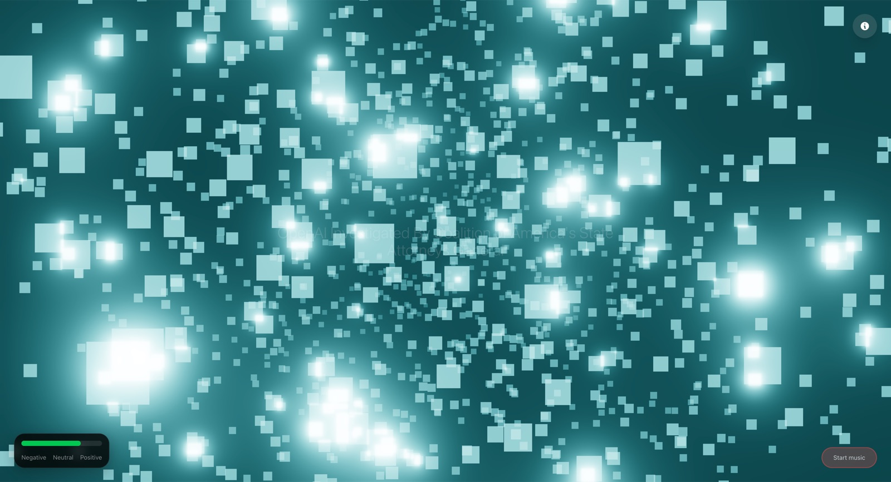

# 🌊 EmotionWave

[](https://madebyhuman.iamjarl.com)

A living Nuxt-based website that reacts to the world's mood. Through real-time sentiment analysis of news and social media, the site's visual expression — colors, animations, and atmosphere — changes automatically.

🌐 **Live Site**: [https://emotionwave.iamjarl.com](https://emotionwave.iamjarl.com) (Vercel)

[](https://emotionwave.iamjarl.com)

## 🎯 Project Purpose

Create a data-driven artwork where the website changes in real-time based on global sentiment. Users get a visual sense of "how the world feels" through an immersive experience combining visual and audio elements.

## 🛠️ Technologies

- **Framework**: Nuxt 4 + Vite
- **UI**: TailwindCSS 4
- **Visuals**: Three.js for particle effects (lazy loaded)
- **Audio**: Tone.js for generative ambient sound (lazy loaded)
- **Data**: Multi-source sentiment analysis (GDELT, keyless BBC/NPR RSS, NewsAPI, The Guardian, Reddit)
- **PWA**: Service worker generated by @vite-pwa/nuxt
- **TypeScript**: Full type safety throughout the application

Exact dependency versions live in [package.json](./package.json).

## 🎨 Features

### Visual Expression
- Dynamic particle system that reacts to sentiment (1000-2000 particles based on device)
- Soft, round particles of varying size, drawn by a custom shader
- **Emotion-driven motion**: joy rises and glows, sadness falls like slow rain, anger is fast and hard-edged, fear trembles and flickers, surprise sparkles; mixed moods blend
- Color transitions based on mood with smooth animations
- **Emotion-aware palette**: when emotion analysis is available, colors blend distinct hues for anger, fear, joy, sadness, surprise and disgust instead of a single negative-positive axis
- Interactive mouse-based particle movement
- Smooth 60fps animations and transitions
- Responsive design with mobile optimization
- GPU-accelerated rendering with WebGL
- **Live headline display**: Rotating article headlines centered on screen, updating every 5 seconds

### Audio Experience
- Generative ambient sound in three Tone.js layers: an evolving FM drone, a filtered noise texture, and bell-like chords with one or two melody notes
- **Harmony follows the mood**: brighter moods use C pentatonic major, darker moods C pentatonic minor, with 3–4 chord voicings per mood
- **Emotion-aware**: when emotion data is available, the dominant emotion picks the harmony (joy brightest, surprise light, sadness and disgust subdued, fear and anger darkest); otherwise the sentiment score does
- **Pacing**: a new phrase roughly every 5–13 seconds, sparser when the mood is negative and more active when it is positive
- **Continuous shaping**: the mood also moves the drone root, the noise colour, filter cutoffs, timbre, reverb, chorus and delay, all ramped over several seconds
- Updates while playing when the mood changes
- Volume control with smooth transitions
- User interaction required to start audio (browser policy)

### Sentiment Analysis
- **Multi-source aggregation**: Combines GDELT, keyless BBC/NPR RSS feeds, NewsAPI (optional), The Guardian (optional) and Reddit
- **Emotion categories**: headlines are also classified into seven emotions (Ekman 6 + neutral) and aggregated into a "world emotion" that drives the palette and musical scale
- **Advanced analysis**: Optional HuggingFace Inference API integration for improved sentiment detection
  - Strategically used on top 10 articles for balance between accuracy and performance
  - Remaining articles use fast keyword-based analysis
- **Keyword-based fallback**: Enhanced keyword analysis when APIs don't provide explicit sentiment scores
- **Reddit integration**: Social media sentiment with full weight for valuable real-world mood signals
- Real-time analysis of news articles from multiple sources
- Intensity-weighted average sentiment across all sources (prioritizing strong emotional signals)
- Filters out articles with zero sentiment (missing data) for improved accuracy
- Retry logic with exponential backoff for reliable data fetching
- 30-second cache to limit API calls
- Sentiment score range: -1 (negative) to +1 (positive)
- Smooth animated transitions between sentiment scores
- Automatic fallback to dynamic time-based data if APIs fail
- Graceful degradation: works even if some APIs are unavailable
- **Article headlines**: API returns article titles for live display on the site

### Progressive Web App (PWA)
- Offline functionality with service worker
- Installable on mobile devices
- Fullscreen experience
- Optimized for mobile performance

### SEO & Social Sharing
- Comprehensive meta tags (Open Graph, Twitter Cards)
- Structured data (JSON-LD) for rich snippets
- Dynamic sitemap.xml and robots.txt generation
- Canonical URLs for proper indexing
- Optimized favicon set for all platforms

## 📊 Sentiment Visualization Mapping

Without emotion data, the sentiment score alone sets the colour and harmony:

| Score         | Particle colour              | Harmony              |
|---------------|------------------------------|----------------------|
| `-1 to -0.5`  | Deep indigo to slate blue    | C pentatonic minor   |
| `-0.5 to 0`   | Slate blue to cool blue      | C pentatonic minor   |
| `0 to 0.5`    | Cool blue to teal            | C pentatonic major   |
| `0.5 to 1`    | Teal to warm gold            | C pentatonic major   |

With emotion data, the palette blends the emotion hues and the dominant emotion picks the harmony instead. Either way, the background is the particle colour at 12% brightness, so it tints with the mood. The drone root (C2, Eb2, G2) and the noise colour (brown, pink, white) switch at scores of -0.3 and 0.3.

## 🚀 Quick Start

### Prerequisites

- Node.js 22 (the version CI uses)
- npm or yarn

### Installation

1. **Clone the repository:**
```bash
git clone https://github.com/JarlLyng/EmotionWave.git
cd EmotionWave
```

2. **Install dependencies:**
```bash
npm install
```

3. **Create a `.env` file** (optional):
```env
NUXT_PUBLIC_SITE_URL=http://localhost:3000
NUXT_PUBLIC_BASE_URL=/
```

4. **Start the development server:**
```bash
npm run dev
```

The application will be available at `http://localhost:3000`

### Available Scripts

- `npm run dev` - Start development server with hot-reload
- `npm run build` - Build for production (SSR)
- `npm run generate` - Generate static site for deployment
- `npm run preview` - Preview production build locally

## 📚 Documentation

- **[ARCHITECTURE.md](./ARCHITECTURE.md)** - Technical architecture and component structure
- **[DEPLOYMENT.md](./DEPLOYMENT.md)** - Deployment guides for various platforms
- **[CONFIGURATION.md](./CONFIGURATION.md)** - Configuration options and environment variables
- **[CONTRIBUTING.md](./CONTRIBUTING.md)** - Guidelines for contributing

## 🐛 Known Issues & Limitations

1. **Static Hosting Limitations**
   - Server-side API routes don't work on static hosting (GitHub Pages, etc.)
   - Application uses fallback data automatically on static hosting
   - For full functionality with HuggingFace sentiment analysis, deploy to Vercel

2. **Audio Autoplay**
   - Browser policies require user interaction to start audio
   - User must click the sound button to enable audio

3. **GDELT API Rate Limits**
   - May be rate-limited during high traffic
   - Fallback data ensures application always works

## 🔒 Security

- No sensitive data exposed in client-side code
- Optional API keys are environment variables on Vercel, read only on the server
- Service worker uses secure context
- HTTPS required for PWA features

## 📈 Performance

Performance-focused by design:

- **Lazy loading**: Three.js and Tone.js are loaded on demand, kept out of the initial bundle
- **GPU-accelerated rendering**: WebGL with device-aware particle counts (1000 on mobile, 2000 on desktop)
- **Server-side caching**: 30-second cache on the sentiment API to limit upstream calls
- **Bundle size**: ~635KB gzipped production build

## 🤝 Contributing

Contributions are welcome! Please see [CONTRIBUTING.md](./CONTRIBUTING.md) for guidelines.

## 📝 License

This project is licensed under the MIT License - see the LICENSE file for details.

## 🙏 Acknowledgments

- **GDELT** for news data
- **Tone.js** for audio synthesis
- **Three.js** for 3D graphics and particle effects
- **Nuxt** team for the amazing framework

## 📞 Support

For issues, questions, or contributions, please open an issue on GitHub.

---

**Built with ❤️ using Nuxt 4, Vue 3, Three.js, and Tone.js**
